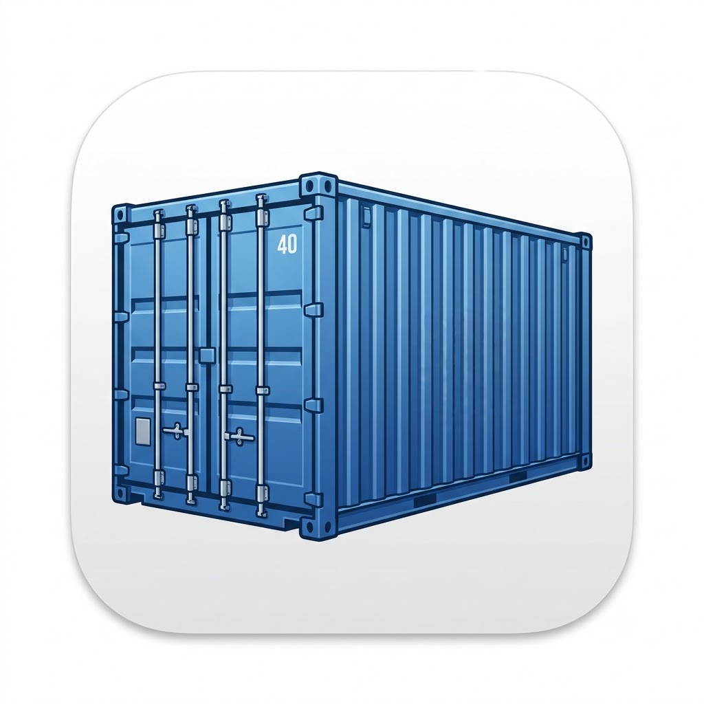

<p align="center">
  
</p>

<h1 align="center">Skipper</h1>

<p align="center">The friendly helm for <strong>Apple Containers</strong>.</p>

A native macOS app for managing **Apple Containers** — like Docker Desktop, but
built on Apple's `container` runtime. Skipper takes the wheel on a dense CLI:
modern SwiftUI design, no terminal required.

 

## Features

- **Engine control** — start/stop the background container service from the sidebar; a friendly splash guides you when it's offline.
- **Containers** — see running and stopped containers at a glance with live status pills. Start, stop, restart, delete, open published ports in your browser, and inspect details (resources, network, environment, raw JSON) and logs.
- **Images** — browse local images, **pull** new ones (with one-click suggestions and live progress), **run** them through a friendly form, or delete.
- **Run** — a guided sheet that hides CLI flags: name, port mappings, environment variables, shared folders, CPU/memory — with a folder picker for volumes.
- **Build** — point at a folder with a `Dockerfile`/`Containerfile`, tag it, and watch the build stream live.
- **Volumes** — list and remove persistent volumes.

Everything auto-refreshes every few seconds.

## Requirements

- macOS 14 or later (Apple Silicon)
- [Apple Containers](https://github.com/apple/container) — `brew install container`
- Swift toolchain (Xcode or Command Line Tools) to build

## Build & run

```bash
./build.sh            # release build → Skipper.app
open Skipper.app
```

Or for development:

```bash
swift build
swift run ContainerUI
```

`build.sh` compiles with SwiftPM, assembles a proper `Skipper.app` bundle with an
`Info.plist` and app icon, and applies an ad-hoc code signature so it launches
without Gatekeeper warnings. The SwiftPM target/binary is still named
`ContainerUI` (hence `swift run ContainerUI`).

## How it works

The app shells out to the `container` CLI and parses its `--format json`
output — there's no private API or daemon integration. The whole CLI surface is
wrapped in [`ContainerEngine.swift`](Sources/ContainerUI/ContainerEngine.swift),
which runs commands out-of-process (draining stdout/stderr concurrently to avoid
pipe deadlocks) and exposes a streaming variant for `pull`/`build`/logs.

```
Sources/ContainerUI/
├── App.swift               # @main entry, window + menu commands
├── AppModel.swift          # observable state, auto-refresh, actions
├── ContainerEngine.swift   # async wrapper around the `container` CLI
├── Models.swift            # Codable models matching the CLI's JSON
└── Views/
    ├── RootView.swift          # split view, sidebar, engine status
    ├── Components.swift         # status pills, cards, flow layout, toasts
    ├── ContainersView.swift     # container list + rows
    ├── ContainerDetailView.swift# overview / logs / inspect tabs
    ├── LogsView.swift
    ├── ImagesView.swift
    ├── RunSheet.swift
    ├── PullSheet.swift
    ├── BuildView.swift
    └── VolumesView.swift
```

## Notes

- The CLI path is auto-detected (`/opt/homebrew/bin/container`, `/usr/local/bin`, or via `which`).
- This is an unofficial project and is not affiliated with Apple.
